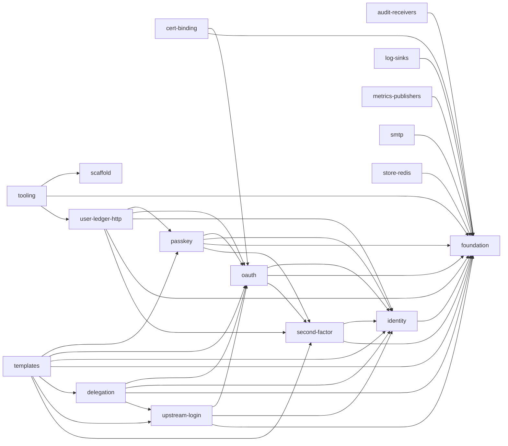

# Dependencies

Generated by `references` from each workspace package's card and manifest: do not edit; run `pnpm --filter @mod/references run configuration`.
What each workspace package depends on to run: the workspace packages its manifest names in `dependencies` and `peerDependencies`, tests' left out. The guard holds shipped imports to the manifest (G8, G34) and the direction to the kinds' order (G10); a package's card says what it takes from each.

## Between directories

An arrow from a directory under `modules` to another: a package in the first depends on one in the second.

## By package

### audit-receivers

| Package | Kind | Depends on |
|---|---|---|
| `@mod/audit-http` | adapter | `@mod/audit`, `@mod/kernel`, `@mod/outbound`, `@mod/outbound-policy`, `@mod/url-setting` |
| `@mod/audit-stdout` | adapter | `@mod/audit`, `@mod/kernel` |

### cert-binding

| Package | Kind | Depends on |
|---|---|---|
| `@mod/mtls` | feature | `@mod/client-certificate`, `@mod/issuer`, `@mod/kernel`, `@mod/outbound`, `@mod/outbound-policy`, `@mod/sender-binding` |

### delegation

| Package | Kind | Depends on |
|---|---|---|
| `@mod/federation-grants` | feature | `@mod/audit`, `@mod/clients`, `@mod/csrf`, `@mod/http`, `@mod/kernel`, `@mod/login-gates`, `@mod/rate-limit`, `@mod/redirect-uris`, `@mod/request-source`, `@mod/seal`, `@mod/subject-revocation`, `@mod/upstreams` |
| `@mod/federation-grants-connect` | feature | `@mod/federation-grants`, `@mod/http`, `@mod/kernel`, `@mod/request-source`, `@mod/session`, `@mod/upstream-round-trip`, `@mod/upstreams`, `@mod/url-setting`, `@mod/users` |

### foundation

| Package | Kind | Depends on |
|---|---|---|
| `@mod/added-claims` | foundation | none |
| `@mod/address-reach` | foundation | `@mod/url-setting` |
| `@mod/audit` | foundation | `@mod/kernel`, `@mod/metrics` |
| `@mod/client-certificate` | foundation | `@mod/kernel` |
| `@mod/config-files` | foundation | `@mod/kernel` |
| `@mod/cookies` | foundation | `@mod/http`, `@mod/kernel`, `@mod/request-source` |
| `@mod/external-jwt` | foundation | `@mod/kernel`, `@mod/keys`, `@mod/outbound` |
| `@mod/http` | foundation | `@mod/client-certificate`, `@mod/kernel`, `@mod/request-source`, `@mod/url-setting` |
| `@mod/http-ops` | feature | `@mod/http`, `@mod/kernel`, `@mod/metrics` |
| `@mod/kernel` | common | none |
| `@mod/keys` | foundation | `@mod/http`, `@mod/kernel` |
| `@mod/labels` | foundation | none |
| `@mod/mail` | foundation | `@mod/kernel` |
| `@mod/metrics` | foundation | `@mod/kernel` |
| `@mod/outbound` | foundation | `@mod/address-reach`, `@mod/kernel`, `@mod/outbound-policy`, `@mod/url-setting` |
| `@mod/outbound-policy` | foundation | `@mod/address-reach`, `@mod/kernel`, `@mod/url-setting` |
| `@mod/rate-limit` | foundation | `@mod/audit`, `@mod/http`, `@mod/kernel`, `@mod/metrics`, `@mod/request-source`, `@mod/store` |
| `@mod/records` | capability | `@mod/kernel`, `@mod/store` |
| `@mod/request-source` | foundation | `@mod/client-certificate`, `@mod/kernel` |
| `@mod/seal` | foundation | `@mod/kernel`, `@mod/keys` |
| `@mod/secret-hash` | foundation | `@mod/kernel` |
| `@mod/store` | foundation | `@mod/kernel` |
| `@mod/url-setting` | foundation | none |

### identity

| Package | Kind | Depends on |
|---|---|---|
| `@mod/client-documents` | feature | `@mod/clients`, `@mod/kernel` |
| `@mod/clients` | feature | `@mod/audit`, `@mod/http`, `@mod/kernel`, `@mod/request-source`, `@mod/secret-hash` |
| `@mod/csrf` | feature | `@mod/cookies`, `@mod/http`, `@mod/kernel` |
| `@mod/login-attributes` | feature | `@mod/users` |
| `@mod/login-gates` | feature | `@mod/http`, `@mod/kernel`, `@mod/session`, `@mod/url-setting` |
| `@mod/login-password` | feature | `@mod/audit`, `@mod/csrf`, `@mod/http`, `@mod/kernel`, `@mod/login-attributes`, `@mod/login-gates`, `@mod/rate-limit`, `@mod/request-source`, `@mod/users` |
| `@mod/session` | feature | `@mod/cookies`, `@mod/http`, `@mod/kernel`, `@mod/login-attributes`, `@mod/subject-revocation` |
| `@mod/session-lifecycle` | adapter | `@mod/cookies`, `@mod/http`, `@mod/kernel`, `@mod/login-attributes`, `@mod/session`, `@mod/subject-revocation` |
| `@mod/session-participants` | feature | `@mod/kernel`, `@mod/session` |
| `@mod/session-requirements` | feature | `@mod/kernel`, `@mod/session` |
| `@mod/subject-attributes` | feature | `@mod/kernel`, `@mod/login-attributes`, `@mod/session`, `@mod/users` |
| `@mod/subject-revocation` | feature | `@mod/kernel` |
| `@mod/users` | feature | `@mod/kernel`, `@mod/mail`, `@mod/secret-hash` |

### log-sinks

| Package | Kind | Depends on |
|---|---|---|
| `@mod/log-stdout` | adapter | `@mod/kernel` |

### metrics-publishers

| Package | Kind | Depends on |
|---|---|---|
| `@mod/metrics-prometheus` | adapter | `@mod/http`, `@mod/kernel`, `@mod/metrics` |

### oauth

| Package | Kind | Depends on |
|---|---|---|
| `@mod/acr` | feature | `@mod/issuer`, `@mod/kernel`, `@mod/login-gates` |
| `@mod/authorize` | feature | `@mod/acr`, `@mod/audit`, `@mod/client-allowance`, `@mod/client-documents`, `@mod/clients`, `@mod/code-grant`, `@mod/consent`, `@mod/grants`, `@mod/http`, `@mod/issuer`, `@mod/kernel`, `@mod/login-gates`, `@mod/rate-limit`, `@mod/reauth`, `@mod/redirect-uris`, `@mod/request-source`, `@mod/session`, `@mod/token-endpoint`, `@mod/tokens`, `@mod/url-setting` |
| `@mod/claims-selection` | feature | `@mod/client-allowance`, `@mod/clients`, `@mod/code-grant`, `@mod/grants`, `@mod/kernel` |
| `@mod/client-allowance` | feature | `@mod/clients`, `@mod/kernel` |
| `@mod/client-assertion` | feature | `@mod/clients`, `@mod/external-jwt`, `@mod/http`, `@mod/issuer`, `@mod/kernel`, `@mod/keys`, `@mod/outbound`, `@mod/outbound-policy`, `@mod/token-endpoint`, `@mod/url-setting` |
| `@mod/client-credentials` | feature | `@mod/client-allowance`, `@mod/grants`, `@mod/issuer`, `@mod/kernel` |
| `@mod/clients-cimd` | feature | `@mod/client-allowance`, `@mod/client-documents`, `@mod/clients`, `@mod/code-grant`, `@mod/grants`, `@mod/issuer`, `@mod/kernel`, `@mod/outbound`, `@mod/outbound-policy`, `@mod/refresh`, `@mod/url-setting` |
| `@mod/code-grant` | feature | `@mod/client-allowance`, `@mod/clients`, `@mod/grants`, `@mod/issuer`, `@mod/kernel`, `@mod/sender-binding`, `@mod/session`, `@mod/tokens` |
| `@mod/consent` | feature | `@mod/audit`, `@mod/client-documents`, `@mod/clients`, `@mod/csrf`, `@mod/http`, `@mod/kernel`, `@mod/request-source`, `@mod/session`, `@mod/url-setting` |
| `@mod/device-grant` | feature | `@mod/audit`, `@mod/client-allowance`, `@mod/clients`, `@mod/csrf`, `@mod/grants`, `@mod/http`, `@mod/issuer`, `@mod/kernel`, `@mod/rate-limit`, `@mod/request-source`, `@mod/session`, `@mod/subject-revocation`, `@mod/token-endpoint`, `@mod/tokens`, `@mod/url-setting` |
| `@mod/discovery` | feature | `@mod/http`, `@mod/issuer`, `@mod/kernel` |
| `@mod/dpop` | feature | `@mod/http`, `@mod/issuer`, `@mod/kernel`, `@mod/keys`, `@mod/sender-binding` |
| `@mod/exchange-id-tokens` | feature | `@mod/clients`, `@mod/external-jwt`, `@mod/kernel`, `@mod/subject-revocation`, `@mod/token-exchange`, `@mod/users` |
| `@mod/grants` | feature | `@mod/clients`, `@mod/http`, `@mod/kernel`, `@mod/sender-binding`, `@mod/tokens` |
| `@mod/issuer` | feature | `@mod/http`, `@mod/kernel`, `@mod/url-setting` |
| `@mod/jwt-bearer` | feature | `@mod/client-allowance`, `@mod/clients`, `@mod/external-jwt`, `@mod/grants`, `@mod/issuer`, `@mod/kernel`, `@mod/keys`, `@mod/outbound`, `@mod/outbound-policy`, `@mod/subject-revocation`, `@mod/token-endpoint`, `@mod/users` |
| `@mod/jwt-bearer-id-tokens` | feature | `@mod/exchange-id-tokens`, `@mod/jwt-bearer`, `@mod/kernel` |
| `@mod/jwt-bearer-users` | feature | `@mod/jwt-bearer`, `@mod/kernel`, `@mod/users` |
| `@mod/logout` | feature | `@mod/audit`, `@mod/csrf`, `@mod/http`, `@mod/kernel`, `@mod/request-source`, `@mod/session` |
| `@mod/mfa-acr` | feature | `@mod/acr`, `@mod/kernel`, `@mod/mfa`, `@mod/mfa-extensions`, `@mod/mfa-reading` |
| `@mod/oidc` | feature | `@mod/code-grant`, `@mod/issuer`, `@mod/kernel`, `@mod/keys`, `@mod/subject-attributes`, `@mod/users` |
| `@mod/reauth` | feature | `@mod/kernel`, `@mod/session` |
| `@mod/redirect-uris` | feature | `@mod/client-documents`, `@mod/clients` |
| `@mod/refresh` | feature | `@mod/audit`, `@mod/client-allowance`, `@mod/clients`, `@mod/code-grant`, `@mod/grants`, `@mod/issuer`, `@mod/kernel`, `@mod/sender-binding`, `@mod/session`, `@mod/session-participants`, `@mod/subject-revocation`, `@mod/token-control`, `@mod/tokens` |
| `@mod/resource-indicators` | feature | `@mod/grants`, `@mod/kernel` |
| `@mod/rp-logout` | feature | `@mod/audit`, `@mod/clients`, `@mod/code-grant`, `@mod/http`, `@mod/issuer`, `@mod/kernel`, `@mod/keys`, `@mod/oidc`, `@mod/outbound`, `@mod/outbound-policy`, `@mod/rate-limit`, `@mod/redirect-uris`, `@mod/request-source`, `@mod/session`, `@mod/session-participants` |
| `@mod/sender-binding` | feature | `@mod/clients`, `@mod/http`, `@mod/issuer`, `@mod/kernel` |
| `@mod/session-grant` | feature | `@mod/client-allowance`, `@mod/csrf`, `@mod/grants`, `@mod/issuer`, `@mod/kernel`, `@mod/session`, `@mod/tokens` |
| `@mod/session-tokens` | feature | `@mod/grants`, `@mod/kernel`, `@mod/session`, `@mod/session-participants`, `@mod/tokens` |
| `@mod/subject-tokens` | feature | `@mod/kernel`, `@mod/subject-revocation`, `@mod/tokens` |
| `@mod/token-control` | feature | `@mod/audit`, `@mod/client-allowance`, `@mod/clients`, `@mod/http`, `@mod/issuer`, `@mod/kernel`, `@mod/rate-limit`, `@mod/request-source`, `@mod/token-endpoint`, `@mod/tokens` |
| `@mod/token-denylist` | feature | `@mod/kernel` |
| `@mod/token-endpoint` | feature | `@mod/audit`, `@mod/client-allowance`, `@mod/clients`, `@mod/grants`, `@mod/http`, `@mod/issuer`, `@mod/kernel`, `@mod/rate-limit`, `@mod/request-source`, `@mod/sender-binding`, `@mod/tokens` |
| `@mod/token-exchange` | feature | `@mod/client-allowance`, `@mod/clients`, `@mod/grants`, `@mod/issuer`, `@mod/kernel`, `@mod/sender-binding`, `@mod/tokens` |
| `@mod/tokens` | feature | `@mod/added-claims`, `@mod/http`, `@mod/issuer`, `@mod/kernel`, `@mod/keys`, `@mod/sender-binding`, `@mod/token-denylist` |
| `@mod/userinfo` | feature | `@mod/http`, `@mod/issuer`, `@mod/kernel`, `@mod/oidc`, `@mod/sender-binding`, `@mod/session`, `@mod/session-tokens`, `@mod/tokens` |
| `@mod/verified-email` | feature | `@mod/client-credentials`, `@mod/kernel`, `@mod/subject-attributes`, `@mod/tokens`, `@mod/users` |

### passkey

| Package | Kind | Depends on |
|---|---|---|
| `@mod/login-passkey` | feature | `@mod/audit`, `@mod/cookies`, `@mod/csrf`, `@mod/http`, `@mod/kernel`, `@mod/login-attributes`, `@mod/login-gates`, `@mod/mfa-extensions`, `@mod/passkeys`, `@mod/rate-limit`, `@mod/request-source`, `@mod/session`, `@mod/subject-revocation`, `@mod/users`, `@mod/webauthn` |
| `@mod/mfa-reset-passkeys` | feature | `@mod/kernel`, `@mod/mfa-reset`, `@mod/passkey-reset` |
| `@mod/mfa-webauthn` | feature | `@mod/kernel`, `@mod/mfa`, `@mod/mfa-extensions`, `@mod/subject-attributes`, `@mod/users`, `@mod/webauthn` |
| `@mod/passkey-registration` | feature | `@mod/audit`, `@mod/csrf`, `@mod/http`, `@mod/kernel`, `@mod/labels`, `@mod/passkeys`, `@mod/rate-limit`, `@mod/request-source`, `@mod/session`, `@mod/subject-revocation` |
| `@mod/passkey-reset` | feature | `@mod/audit`, `@mod/kernel`, `@mod/passkeys`, `@mod/subject-revocation` |
| `@mod/passkey-witness` | feature | `@mod/kernel` |
| `@mod/passkey-witnessing` | feature | `@mod/audit`, `@mod/kernel`, `@mod/passkey-witness`, `@mod/passkeys` |
| `@mod/passkeys` | feature | `@mod/kernel`, `@mod/passkey-witness`, `@mod/webauthn` |
| `@mod/webauthn` | feature | `@mod/kernel` |
| `@mod/webauthn-login` | feature | `@mod/audit`, `@mod/client-allowance`, `@mod/grants`, `@mod/http`, `@mod/issuer`, `@mod/kernel`, `@mod/passkeys`, `@mod/rate-limit`, `@mod/refresh`, `@mod/subject-revocation` |

### scaffold

| Package | Kind | Depends on |
|---|---|---|
| `@mod/app-output` | assembly | none |
| `@mod/combinations` | assembly | `@mod/kinds` |
| `@mod/create-app` | assembly | `@mod/app-output`, `@mod/combinations` |
| `@mod/kinds` | assembly | none |
| `@mod/trial` | assembly | none |

### second-factor

| Package | Kind | Depends on |
|---|---|---|
| `@mod/mfa` | feature | `@mod/audit`, `@mod/kernel`, `@mod/labels`, `@mod/login-gates`, `@mod/mfa-binding`, `@mod/mfa-extensions`, `@mod/mfa-managing`, `@mod/mfa-reading`, `@mod/mfa-witness`, `@mod/seal` |
| `@mod/mfa-binding` | feature | `@mod/kernel`, `@mod/mfa-extensions`, `@mod/mfa-reading` |
| `@mod/mfa-binding-proof` | feature | `@mod/kernel`, `@mod/mfa`, `@mod/mfa-extensions`, `@mod/mfa-reading`, `@mod/seal` |
| `@mod/mfa-email` | feature | `@mod/kernel`, `@mod/mail`, `@mod/mfa`, `@mod/mfa-binding-proof`, `@mod/mfa-extensions`, `@mod/subject-attributes`, `@mod/users` |
| `@mod/mfa-email-proof` | feature | `@mod/kernel`, `@mod/mfa-binding-proof`, `@mod/mfa-email`, `@mod/users` |
| `@mod/mfa-email-wording` | adapter | `@mod/kernel`, `@mod/mail`, `@mod/mfa-email` |
| `@mod/mfa-enrollment` | feature | `@mod/http`, `@mod/kernel`, `@mod/labels`, `@mod/mfa`, `@mod/mfa-binding`, `@mod/mfa-binding-proof`, `@mod/mfa-extensions`, `@mod/mfa-flows`, `@mod/mfa-managing`, `@mod/session`, `@mod/subject-revocation` |
| `@mod/mfa-entry` | feature | `@mod/kernel`, `@mod/mfa`, `@mod/mfa-extensions`, `@mod/mfa-reading`, `@mod/session`, `@mod/session-requirements` |
| `@mod/mfa-extensions` | feature | `@mod/kernel` |
| `@mod/mfa-flows` | feature | `@mod/audit`, `@mod/cookies`, `@mod/csrf`, `@mod/http`, `@mod/kernel`, `@mod/login-gates`, `@mod/mfa`, `@mod/mfa-extensions`, `@mod/mfa-reading`, `@mod/rate-limit`, `@mod/request-source`, `@mod/session`, `@mod/subject-attributes`, `@mod/subject-revocation` |
| `@mod/mfa-management` | feature | `@mod/csrf`, `@mod/http`, `@mod/kernel`, `@mod/mfa`, `@mod/mfa-entry`, `@mod/mfa-managing`, `@mod/mfa-reading`, `@mod/rate-limit`, `@mod/session` |
| `@mod/mfa-managing` | feature | `@mod/kernel`, `@mod/mfa-reading` |
| `@mod/mfa-reading` | feature | `@mod/kernel`, `@mod/mfa-extensions` |
| `@mod/mfa-recovery` | feature | `@mod/kernel`, `@mod/mfa`, `@mod/mfa-extensions` |
| `@mod/mfa-reset` | feature | `@mod/audit`, `@mod/kernel`, `@mod/mfa`, `@mod/mfa-flows`, `@mod/mfa-managing`, `@mod/mfa-reading`, `@mod/rate-limit`, `@mod/subject-revocation` |
| `@mod/mfa-revocation` | feature | `@mod/kernel`, `@mod/mfa`, `@mod/mfa-managing`, `@mod/subject-revocation` |
| `@mod/mfa-totp` | feature | `@mod/http`, `@mod/kernel`, `@mod/mfa`, `@mod/mfa-extensions` |
| `@mod/mfa-witness` | feature | `@mod/kernel` |
| `@mod/mfa-witnessing` | feature | `@mod/audit`, `@mod/kernel`, `@mod/mfa`, `@mod/mfa-extensions`, `@mod/mfa-reading`, `@mod/mfa-witness` |

### smtp

| Package | Kind | Depends on |
|---|---|---|
| `@mod/mail-smtp` | adapter | `@mod/address-reach`, `@mod/kernel`, `@mod/mail`, `@mod/url-setting` |

### store-redis

| Package | Kind | Depends on |
|---|---|---|
| `@mod/redis` | adapter | `@mod/kernel`, `@mod/store` |

### templates

| Package | Kind | Depends on |
|---|---|---|
| `@mod/authorize-store` | wiring | `@mod/kernel`, `@mod/reauth`, `@mod/records`, `@mod/store` |
| `@mod/claims-selection-store` | wiring | `@mod/claims-selection`, `@mod/kernel`, `@mod/records`, `@mod/store` |
| `@mod/client-assertion-store` | wiring | `@mod/client-assertion`, `@mod/kernel`, `@mod/records`, `@mod/store` |
| `@mod/code-grant-store` | wiring | `@mod/code-grant`, `@mod/kernel`, `@mod/records`, `@mod/store` |
| `@mod/consent-store` | wiring | `@mod/consent`, `@mod/kernel`, `@mod/records`, `@mod/store` |
| `@mod/device-grant-store` | wiring | `@mod/device-grant`, `@mod/kernel`, `@mod/records`, `@mod/store` |
| `@mod/dpop-store` | wiring | `@mod/dpop`, `@mod/kernel`, `@mod/records`, `@mod/store` |
| `@mod/exchange-id-tokens-store` | wiring | `@mod/exchange-id-tokens`, `@mod/kernel`, `@mod/records`, `@mod/store` |
| `@mod/federation-grants-store` | wiring | `@mod/federation-grants`, `@mod/kernel`, `@mod/records`, `@mod/store` |
| `@mod/federation-tokens-store` | wiring | `@mod/federation-tokens`, `@mod/kernel`, `@mod/records`, `@mod/store` |
| `@mod/jwt-bearer-store` | wiring | `@mod/jwt-bearer`, `@mod/kernel`, `@mod/records`, `@mod/store` |
| `@mod/mfa-flows-store` | wiring | `@mod/kernel`, `@mod/mfa-flows`, `@mod/records`, `@mod/store` |
| `@mod/mfa-store` | wiring | `@mod/kernel`, `@mod/mfa`, `@mod/records`, `@mod/store` |
| `@mod/refresh-store` | wiring | `@mod/kernel`, `@mod/records`, `@mod/refresh`, `@mod/store` |
| `@mod/rp-logout-store` | wiring | `@mod/kernel`, `@mod/records`, `@mod/rp-logout`, `@mod/store` |
| `@mod/session-store` | wiring | `@mod/kernel`, `@mod/records`, `@mod/session-lifecycle`, `@mod/store` |
| `@mod/session-tokens-store` | wiring | `@mod/kernel`, `@mod/records`, `@mod/session-tokens`, `@mod/store` |
| `@mod/subject-revocation-store` | wiring | `@mod/kernel`, `@mod/records`, `@mod/store`, `@mod/subject-revocation` |
| `@mod/tokens-store` | wiring | `@mod/kernel`, `@mod/records`, `@mod/store`, `@mod/tokens` |
| `@mod/upstream-handoff-store` | wiring | `@mod/kernel`, `@mod/records`, `@mod/store`, `@mod/upstream-handoff` |
| `@mod/upstream-round-trip-store` | wiring | `@mod/kernel`, `@mod/records`, `@mod/store`, `@mod/upstream-round-trip` |
| `@mod/users-store` | wiring | `@mod/kernel`, `@mod/records`, `@mod/store`, `@mod/users` |
| `@mod/webauthn-store` | wiring | `@mod/kernel`, `@mod/passkeys`, `@mod/records`, `@mod/store` |

### tooling

| Package | Kind | Depends on |
|---|---|---|
| `@mod/api-docs` | assembly | none |
| `@mod/conformance` | verification | `@mod/combinations`, `@mod/create-app`, `@mod/trial` |
| `@mod/conformance-code` | verification | `@mod/conformance`, `@mod/conformance-identity`, `@mod/conformance-keys`, `@mod/conformance-legacy`, `@mod/conformance-mtls`, `@mod/conformance-oauth`, `@mod/conformance-second-factor` |
| `@mod/conformance-device` | verification | `@mod/conformance`, `@mod/conformance-identity`, `@mod/conformance-keys`, `@mod/conformance-legacy`, `@mod/conformance-oauth` |
| `@mod/conformance-exchange` | verification | `@mod/conformance`, `@mod/conformance-code`, `@mod/conformance-device`, `@mod/conformance-identity`, `@mod/conformance-keys`, `@mod/conformance-legacy`, `@mod/conformance-oauth` |
| `@mod/conformance-federation` | verification | `@mod/conformance`, `@mod/conformance-code`, `@mod/conformance-identity`, `@mod/conformance-keys`, `@mod/conformance-legacy`, `@mod/conformance-oauth` |
| `@mod/conformance-front` | verification | none |
| `@mod/conformance-identity` | verification | `@mod/conformance`, `@mod/conformance-legacy`, `@mod/ledger-fakes` |
| `@mod/conformance-keys` | verification | `@mod/conformance`, `@mod/conformance-legacy` |
| `@mod/conformance-legacy` | verification | `@mod/conformance` |
| `@mod/conformance-mtls` | verification | `@mod/conformance`, `@mod/conformance-keys`, `@mod/conformance-legacy`, `@mod/conformance-oauth` |
| `@mod/conformance-oauth` | verification | `@mod/conformance`, `@mod/conformance-keys`, `@mod/conformance-legacy` |
| `@mod/conformance-ops` | verification | `@mod/conformance`, `@mod/conformance-keys`, `@mod/conformance-legacy`, `@mod/conformance-oauth` |
| `@mod/conformance-passkey` | verification | `@mod/conformance`, `@mod/conformance-legacy`, `@mod/conformance-oauth`, `@mod/ledger-fakes` |
| `@mod/conformance-recipes` | verification | `@mod/conformance`, `@mod/create-app` |
| `@mod/conformance-second-factor` | verification | `@mod/conformance`, `@mod/conformance-legacy` |
| `@mod/conformance-tunnel` | verification | none |
| `@mod/distribution` | assembly | `@mod/combinations`, `@mod/create-app`, `@mod/trial` |
| `@mod/guard` | verification | `@mod/guard-imports`, `@mod/kinds` |
| `@mod/guard-imports` | verification | none |
| `@mod/interop-clients` | verification | `@mod/conformance`, `@mod/conformance-code`, `@mod/conformance-device`, `@mod/conformance-exchange`, `@mod/conformance-front`, `@mod/conformance-oauth`, `@mod/spec-checklist` |
| `@mod/interop-oidf` | verification | `@mod/conformance`, `@mod/conformance-code`, `@mod/conformance-front`, `@mod/conformance-tunnel`, `@mod/spec-checklist` |
| `@mod/ledger-fakes` | verification | `@mod/ledger-wire` |
| `@mod/references` | assembly | `@mod/app-output`, `@mod/combinations`, `@mod/config-files`, `@mod/create-app`, `@mod/guard-imports`, `@mod/kernel`, `@mod/trial` |
| `@mod/spec-checklist` | verification | `@mod/guard-imports` |

### upstream-login

| Package | Kind | Depends on |
|---|---|---|
| `@mod/federation` | adapter | `@mod/audit`, `@mod/csrf`, `@mod/http`, `@mod/kernel`, `@mod/login-attributes`, `@mod/login-gates`, `@mod/rate-limit`, `@mod/request-source`, `@mod/upstream-handoff`, `@mod/upstream-round-trip`, `@mod/upstreams`, `@mod/url-setting`, `@mod/users` |
| `@mod/federation-link` | feature | `@mod/audit`, `@mod/csrf`, `@mod/http`, `@mod/kernel`, `@mod/session`, `@mod/upstream-handoff`, `@mod/upstreams`, `@mod/url-setting`, `@mod/users` |
| `@mod/federation-tokens` | feature | `@mod/audit`, `@mod/clients`, `@mod/http`, `@mod/kernel`, `@mod/rate-limit`, `@mod/redirect-uris`, `@mod/request-source`, `@mod/seal`, `@mod/sender-binding`, `@mod/session`, `@mod/session-participants`, `@mod/session-tokens`, `@mod/tokens`, `@mod/upstreams` |
| `@mod/idp-apple` | feature | `@mod/external-jwt`, `@mod/kernel`, `@mod/outbound`, `@mod/outbound-policy`, `@mod/upstream-client`, `@mod/upstreams`, `@mod/url-setting` |
| `@mod/idp-github` | feature | `@mod/kernel`, `@mod/outbound`, `@mod/outbound-policy`, `@mod/upstream-client`, `@mod/upstreams`, `@mod/url-setting` |
| `@mod/idp-google` | feature | `@mod/external-jwt`, `@mod/kernel`, `@mod/outbound`, `@mod/outbound-policy`, `@mod/upstream-client`, `@mod/upstreams`, `@mod/url-setting` |
| `@mod/idp-oidc` | feature | `@mod/external-jwt`, `@mod/kernel`, `@mod/outbound`, `@mod/outbound-policy`, `@mod/upstream-client`, `@mod/upstreams`, `@mod/url-setting` |
| `@mod/rp-logout-federation` | feature | `@mod/federation-tokens`, `@mod/kernel`, `@mod/rp-logout` |
| `@mod/upstream-client` | feature | `@mod/external-jwt`, `@mod/kernel`, `@mod/outbound`, `@mod/upstreams`, `@mod/url-setting` |
| `@mod/upstream-handoff` | feature | `@mod/kernel`, `@mod/login-gates`, `@mod/seal`, `@mod/session`, `@mod/upstreams` |
| `@mod/upstream-handoff-seal` | feature | `@mod/kernel`, `@mod/seal`, `@mod/upstream-handoff` |
| `@mod/upstream-round-trip` | feature | `@mod/cookies`, `@mod/http`, `@mod/kernel` |
| `@mod/upstreams` | feature | `@mod/http`, `@mod/kernel`, `@mod/session` |

### user-ledger-http

| Package | Kind | Depends on |
|---|---|---|
| `@mod/jti-ledger-http` | feature | `@mod/jwt-bearer`, `@mod/kernel`, `@mod/keys`, `@mod/outbound`, `@mod/outbound-policy`, `@mod/url-setting` |
| `@mod/ledger-wire` | protocol | none |
| `@mod/mfa-witness-http` | feature | `@mod/kernel`, `@mod/keys`, `@mod/ledger-wire`, `@mod/mfa-witness`, `@mod/outbound`, `@mod/outbound-policy`, `@mod/url-setting` |
| `@mod/passkey-witness-http` | feature | `@mod/kernel`, `@mod/keys`, `@mod/ledger-wire`, `@mod/outbound`, `@mod/outbound-policy`, `@mod/passkey-witness`, `@mod/url-setting` |
| `@mod/signer-keys-http` | feature | `@mod/jwt-bearer`, `@mod/kernel`, `@mod/keys`, `@mod/outbound`, `@mod/outbound-policy`, `@mod/url-setting` |
| `@mod/subject-revocation-http` | feature | `@mod/audit`, `@mod/http`, `@mod/kernel`, `@mod/keys`, `@mod/rate-limit`, `@mod/request-source`, `@mod/subject-revocation`, `@mod/users` |
| `@mod/users-http` | adapter | `@mod/kernel`, `@mod/keys`, `@mod/ledger-wire`, `@mod/outbound`, `@mod/outbound-policy`, `@mod/url-setting`, `@mod/users` |
