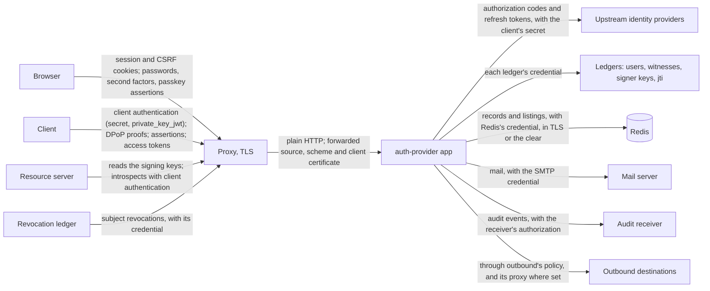

# The scope of an audit

What an audit of a release covers, what lies outside it, where the provider takes the deployment's word, and what flows between the parts.

## In scope

- **One release**: its tag, and the tarballs it published, which the evidence asset's manifest and the SBOM asset's `tarballs.json` name with their hashes.
- **The modules it publishes**: every package the [cards](cards.md) list outside `modules/tooling`, each bundle of them published as `@o3co/auth-provider-<concern>`, and the entrance `@o3co/create-auth-provider` that makes an app of them.
- **The compositions**: the full template with every feature that opts in, which `docs/routes.md` and `docs/attack-surface.md` read; and each pattern the entrance makes (`--pattern`), each composing a part of it. An app composed by hand holds the guarantees only for what it composes, as the security model's promises say of their bridges.
- **The tools that decide what is published or what passed**, under `modules/tooling`, though they are not published: the guard, the release's checks, its evidence and lists, and the checklists' compliance.

## Outside

- What the deployment runs beside the provider: its proxy and TLS, Redis, the upstream identity providers, the ledgers' servers, the mail server, the outbound proxy and the destinations the provider reaches. The provider's side of each is in scope; what each does is the deployment's, held to the trust assumptions below.
- The earlier system (0.17 and before), read only.
- An operator's own modules, and a package from outside the release composed beside it.

## Trust boundaries

Where the provider stops checking and takes the deployment's word, as `docs/security-model.md` states each under "Trust assumptions":

| Boundary | What the provider takes as given | What the deployment must do |
|---|---|---|
| The proxy in front | the forwarded source, scheme and client certificate | strip or overwrite what clients send of them, and be named in `http.trusted-proxies` |
| TLS | that the plain HTTP behind the proxy is the proxy's | terminate TLS, and protect what it terminates |
| The hosts' clocks | each host's time for sessions, codes, tokens, lockouts, keys and revocations | keep the clocks synchronized, with no skew allowed between hosts |
| Plain-text peers | what a `plain-internal` destination, or Redis in the clear, answers | keep them on a network trusted against reading and changing what passes |
| Redis | that it keeps what it was checked at boot to keep | keep its persistence as it was, the replicas persisting, no lagging replica promoted |
| An upstream identity provider | its `amr` and `auth_time`, as far as they are mapped | map them as far as it trusts them |
| The ledgers | each answer as the ledger's word; a signer key ledger's keys as those signing now | keep each ledger's credential known to it and the app alone |
| The origin's other subdomains | that they cannot set the CSRF cookie | keep them its own |
| The configuration | the files and environment holding secrets | let the app alone read them, and trust whoever writes them |
| The outbound proxy | its resolution of names | refuse the addresses `outbound` refuses |

## What flows

What each module reads, keeps and sends, and the secret each holds, is in its card under Data; the secrets among the settings, and the destinations, are in `docs/attack-surface.md`.
